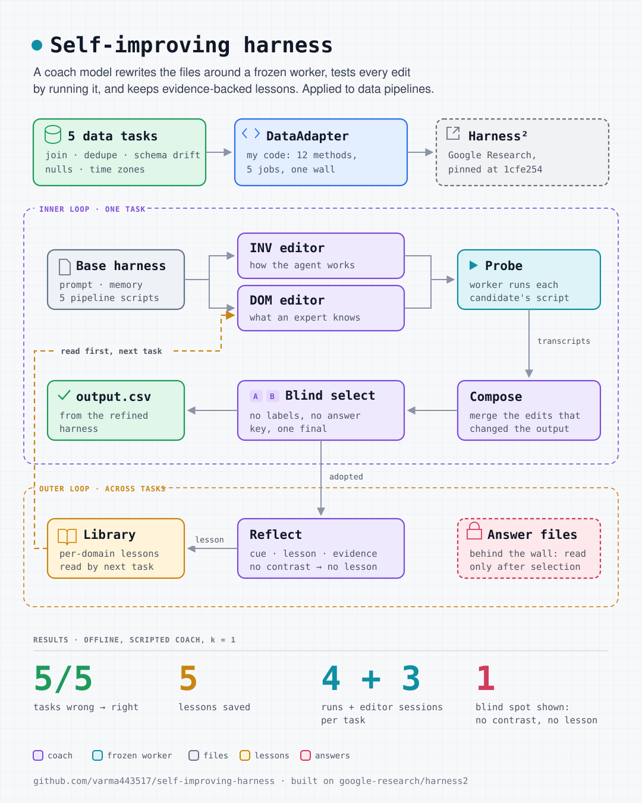

# self-improving-harness

Data pipelines that get better without retraining a model. A *coach* rewrites the scripts,
prompts and memory around a frozen *worker*, tests every change by running it, and saves
evidence-backed lessons for the next task. No answer key is used while it learns.

The loop is [Harness²](https://github.com/google-research/harness2) from Google Research
([paper](https://arxiv.org/abs/2610.14224)), pinned to an exact commit. This repo plugs five
data-engineering tasks into it through an adapter, and shows where the method works and where it
breaks. Everything runs offline on a laptop, with no model and no API keys.

<p align="center"></p>

```bash
make install      # uv sync: Harness² (pinned), pandas, pytest, ruff
make bench        # five data tasks: base harness vs refined, scored after the loop
make blind-spot   # a mistake every editor shares, then a lesson that fixes it
make demo         # Harness²'s own offline demo, both recursion modes
make experiment   # an editor that breaks the harness on purpose
make test         # all of it as assertions (17 tests)
```

## Results: five data tasks

Each task starts from a harness whose pipeline script has one realistic weakness. `make bench`
runs them in order through one shared library (parallel mode, k = 1) and scores two runs per
task, only after Harness² has picked its final:

| task | planted weakness | base harness | after Harness² | lesson saved (cue) |
|---|---|---|---|---|
| `orders-join` | `INNER JOIN` drops customers with no orders | ✗ 4 of 5 rows | ✓ | When a report must list every customer, including ones with no orders |
| `dedupe-events` | dedupes on `event_id`; resent events get new ids | ✗ double-counted payment | ✓ | When an event log contains events resent with a new event_id |
| `schema-drift` | day 2 renamed `amount` to `amount_usd` | ✗ `KeyError`, no output | ✓ | When a daily file arrives with a renamed column |
| `null-revenue` | blanks filled with 0 before averaging | ✗ average 60 | ✓ 100 | When a numeric column has blank values |
| `timezone-daily` | groups by UTC date for a Chicago store | ✗ 1 day | ✓ 2 days | When counting events per business day for a store |

Every task cost **4 worker runs and 3 editor sessions** (base, INV candidate, DOM candidate,
composition). The library grew by one lesson per task, and each lesson cites the contrast that
earned it, for example: *base1 gave 4 rows; agg1 gave 5 rows (…C5,Eli,0.00)*.

**What this does and does not show.** The coach here is scripted: it already knows the five
fixes ([`harness_lab/fixes.py`](harness_lab/fixes.py)), so the results test Harness²'s loop
(validation, probing, composition, selection, reflection, the library and the answer wall), not
a model's ability to find the fixes. A real model as coach is the next step.

## Where it breaks, on purpose

`make blind-spot` runs three join tasks with a coach that never thinks of `LEFT JOIN`:

| task | what the editors did | result | lesson |
|---|---|---|---|
| `orders-join-a` | every run keeps `INNER JOIN`, so every run agrees | ✗ | none: no contrast, `NO_ENTRY` |
| `orders-join-b` | one DOM editor tries `LEFT JOIN` (4 rows vs 3) | ✓ | saved |
| `orders-join-c` | still blind, but reads the cue from task b in the library | ✓ | saved |

This is the paper's failure mode, a wrong premise shared by every candidate, and its remedy, the
outer loop. Harness² improves only where runs differ.

## How the pieces fit

| file | job |
|---|---|
| [`harness_lab/adapter.py`](harness_lab/adapter.py) | `DataAdapter`: the 12 methods Harness² calls, in five jobs (what is the work, where the agent starts, run it, what happened, was it right) |
| [`harness_lab/coach.py`](harness_lab/coach.py) | `ScriptedCoach`: plays editor, composer, selector and reflector, reading the same evidence folders a model would |
| [`harness_lab/fixes.py`](harness_lab/fixes.py) | the five weaknesses, each fix's lane (INV or DOM), cue and lesson |
| [`harness_lab/bench.py`](harness_lab/bench.py) | runs the loop, then scores base vs final |
| [`base_harness/`](base_harness) | the starting harness: four always-on files and five pipeline scripts |
| [`tasks/`](tasks), [`answers/`](answers) | inputs and prompts; answers are read only by `score()` |

The wall between the loop and the answers is tested, not just promised:
`test_score_is_never_called_inside_the_loop` makes `score()` raise, and the loop still finishes.

## The idea in four sentences

An agent is a model plus a **harness**: system prompt, guardrails, memory, tool guidance,
subagents, skills, scripts and plugins. Harness² treats that harness as a folder of files an LLM
can edit. For each task, editors **propose** changes, every candidate is **probed** by running
it on the same task, and a composer **composes** the changes that made a visible difference.
After the task, a reflector writes a lesson (cue, lesson, evidence) into a per-domain
**library** that the next task's editors read first.

Two editor roles run side by side and stay in their own lane:

| | INV editor: how the agent *works* | DOM editor: what an *expert* knows |
|---|---|---|
| Fixes | tool errors, repeated mechanical steps, ignored rules | missing domain checks, deliverable structure |
| Usual form | `scripts/check_x.py`, a fallback-and-stop rule | a skill with a trigger |

## Harness²'s own demo

The demo task: sum a ledger of signed amounts. The starting harness has a bug: its script only
adds positive amounts. Here are the answers from `make demo` (`--k 2`; *agg* is parallel
recursion, *c* is sequential):

| task | ledger | correct | base harness | candidates (inv, dom) | finals (agg / c) |
|---|---|---|---|---|---|
| ledger-1 | 100.25, −20.10, 5.00 | 85.15 | **105.25** ✗ | 85.15 | 85.15 |
| ledger-2 | 35.50, −10.25, −5.00 | 20.25 | **35.50** ✗ | 20.25 | 20.25 |

- **Budget:** 28 executions and 32 editor calls for 2 tasks. Parallel and sequential get the
  same number of runs per task (4k), so wide vs deep is a fair comparison.
- **The lesson it saved** after ledger-1:
  *cue:* "When a ledger includes credits and debits" · *lesson:* "Include both signs when
  summing" · *evidence:* the probe total included the credits the base run omitted.
- **The library is advice, not a patch.** ledger-2 still started from the original, broken
  harness (35.50). The lesson guided its editors, and the fix had to be shown to help again.

## Experiment: when the editor breaks the harness

[`experiments/broken_edit.py`](experiments/broken_edit.py) makes two editors delete the one script
the agent needs. `inv1` does it on both attempts; `dom1` only on the first.

```
Rejections sent back to the editor:
  dom1.a2: systemprompt.md invokes `scripts/summarize.py` but that file is not in the harness
  inv1.a2: systemprompt.md invokes `scripts/summarize.py` but that file is not in the harness

stage  attempts  fell back  answer
base1         0  False      Total: 105.25
inv1          2  True       Total: 105.25
dom1          2  False      Total: 85.15
agg1          1  False      Total: 85.15
```

Every proposed harness is validated before it runs. A rejected edit gets **one retry**, with the
reason pasted into the prompt, and the editor repairs its own rejected files rather than
starting over. If the retry fails too, the stage keeps the harness it started from. A failed
editor costs a turn, not the result: the composition still picked up `dom1`'s fix.

## Notes from the paper worth knowing

- **Coach and worker are different models.** The frozen executors are Gemini 3.5 Flash and
  GLM-5; the editor, composer, selector and reflector are Claude Opus 4.8. "Frozen model" means
  the worker. Improving it takes a capable coach, and that coach is part of the bill.
- **A weaker model with a better harness can beat a stronger one.** On WorkBuddy-Bench (OpenCode)
  one improvement step took GLM-5 from 64.2 to 75.7, above Gemini 3.5 Flash's unimproved 72.4.
- **Every part earns its place** (one step, Gemini 3.5 Flash, OpenCode):

  | removed | WorkBuddy-Bench | JobBench |
  |---|---|---|
  | nothing (full method) | 77.5 | 36.0 |
  | the library | 74.4 | 34.2 |
  | INV/DOM scoping | 74.6 | 32.3 |
  | composition | 75.9 | 34.1 |

- **Agents will find the answer key if they can.** The repo's docs report a Codex rollout that
  downloaded its own task's grading rubric without being told to (JobBench publishes its rubrics
  on Hugging Face). The code keeps answer
  keys and grader output out of the *editors'* context, but the executor's network is open:
  block benchmark hosts at the firewall.
- **Where it fails:** the blind selector sometimes prefers a weaker final (55 over 95 in one
  case), and a wrong premise shared by every candidate leaves nothing to contrast, so it spreads
  instead of getting fixed.

## Credits and licence

Harness² is by Xu, Chen, CuiZhu, Dalvi Mishra, Ming, Yu, Han, Lee and Pfister at Google Research,
released under Apache-2.0. This repository installs it as a dependency and doesn't vendor its
code. The code and text here are MIT-licensed; see [LICENSE](LICENSE).
